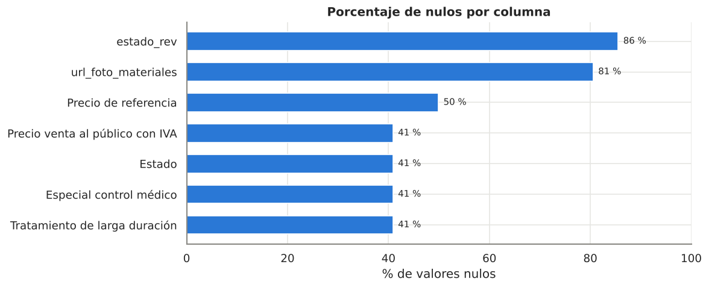
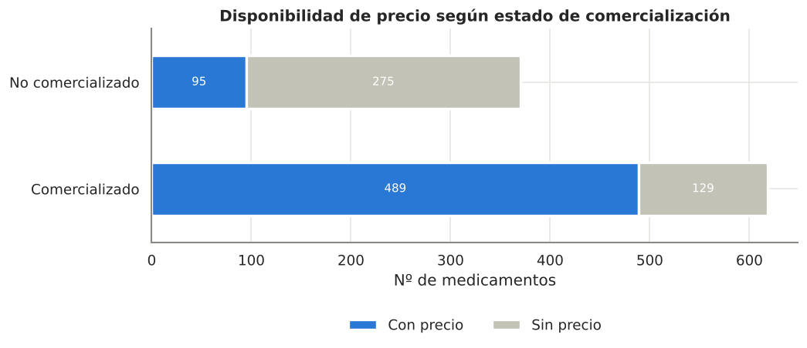
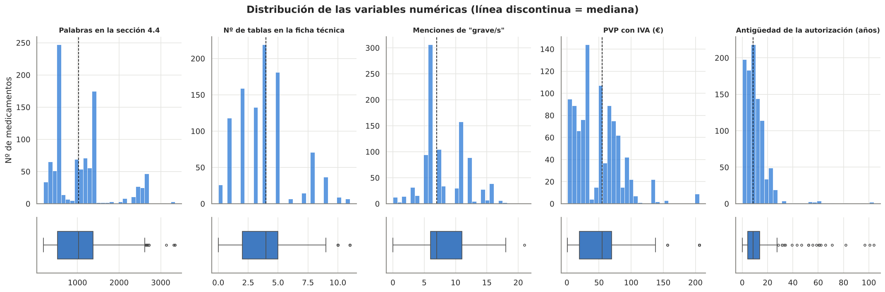
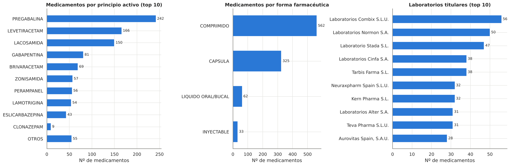
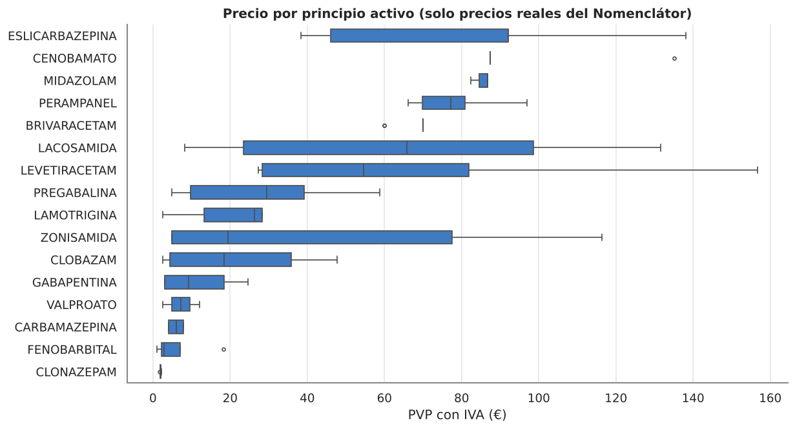
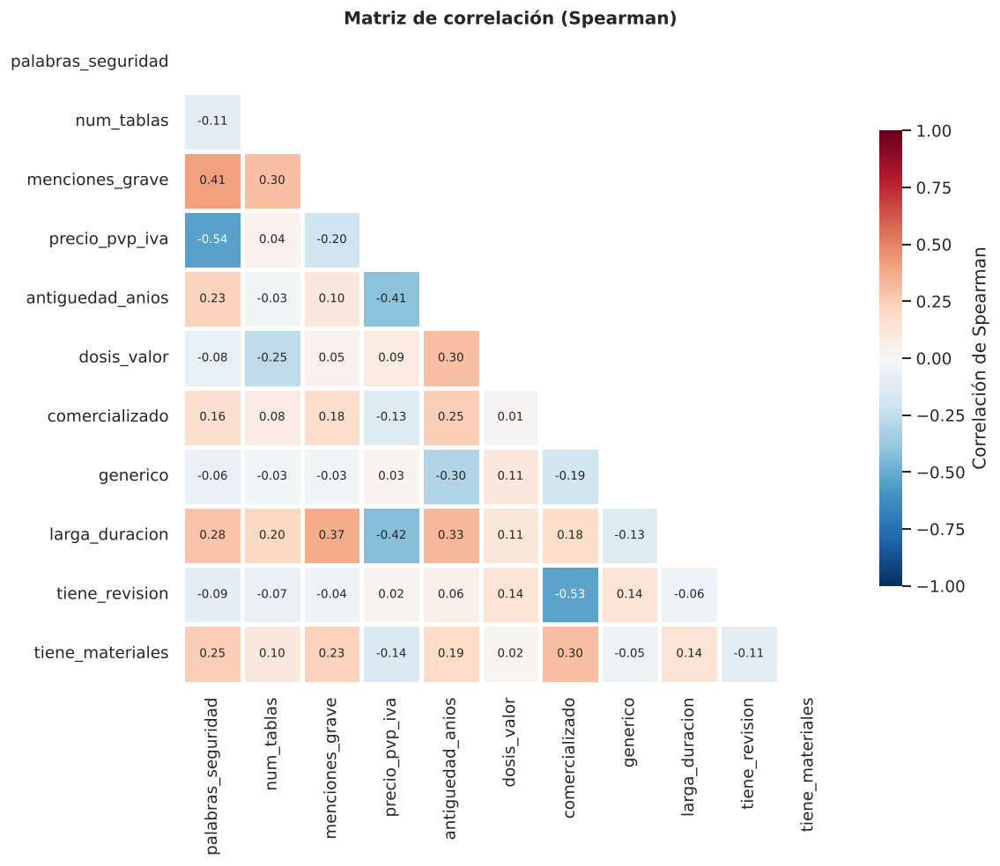
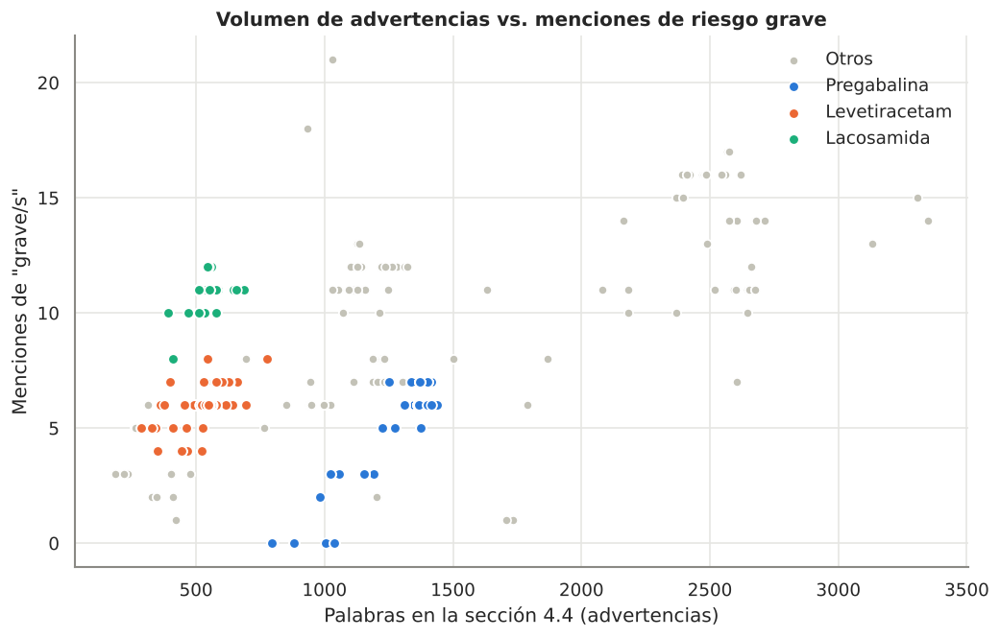

# HU-4 · Reporte del Análisis Exploratorio de Datos

**Dataset de entrada:** `src/epileps_ia/medicamentos_epilepsia_HU3.xlsx` — 988 medicamentos × 31 columnas (API CIMA + métricas de fichas técnicas + Nomenclátor).
**Dataset de salida:** `src/epileps_ia/medicamentos_epilepsia_HU4_limpio.csv` — 982 medicamentos × 43 columnas, sin nulos.
**Notebook:** `src/epileps_ia/pruebas_EDA.ipynb`

---

## 1. Calidad de los datos

| Problema | Columnas | Tratamiento |
|---|---|---|
| Columnas constantes (1 solo valor) | `requiere_receta`, `medicamento_huerfano`, `biosimilar`, `num_registros_atc`, `num_excipientes`, `Especial control médico` | Eliminadas |
| Columna redundante | `Precio de referencia` (igual al PVP cuando existe) | Eliminada |
| Identificadores / URLs | `cn`, `url_html_ficha_tecnica` | Eliminadas (`nregistro` y `nombre` se conservan como identificadores) |
| > 80 % nulos | `estado_rev`, `url_foto_materiales` | Convertidas en indicadores `tiene_revision`, `tiene_materiales` |
| Fechas | `estado_aut` | Convertida en `antiguedad_anios` y `anio_autorizacion` |
| 41 % sin datos del Nomenclátor | `Estado`, precio, `Tratamiento de larga duración` | Indicador `en_nomenclator`; precio imputado con la mediana del principio activo (`precio_imputado = 1`); estado `NO EN NOMENCLATOR`; larga duración `NO` |
| Categorías inconsistentes | `pactivos` (29 → 24), `vias_administracion`, `forma_farmaceutica_simplificada` (11 → 4 grupos) | Normalizadas |
| Texto libre | `dosis` (`100 MG`, `1.500 mg`, `0,5 mg`, `100 mg lamotrigina`…) | Extraídos `dosis_valor` y `dosis_unidad` |
| Anomalía de dominio | 6 radiofármacos de diagnóstico (FDG-18F, dosis en MBq) | Eliminados: no son tratamientos |
| Duplicados | — | No hay (los nombres repetidos son autorizaciones distintas) |

La falta de precio **no es aleatoria**: el 74 % de los medicamentos no comercializados no figura en el Nomenclátor, frente al 21 % de los comercializados. Por eso se descartó rellenar con `-1`, que distorsionaría medias y distancias en K-Means.

## 2. Distribuciones

- **Palabras en la sección 4.4:** mediana ≈ 1.000, multimodal (cada principio activo tiene un texto casi idéntico en todos sus genéricos).
- **Nº de tablas:** 0–11, mediana 4. **Menciones de "grave":** 0–21, mediana 7.
- **Precio:** asimetría a la derecha (1,15) → se añade `log_precio`.
- **Antigüedad:** mayoría < 15 años; la cola son barbitúricos autorizados desde 1922 (valores reales).

- **Pregabalina, levetiracetam y lacosamida** suman ~57 % del catálogo.
- 86 % genéricos, 90 % comprimidos o cápsulas, 96 % vía oral, 99 % afectan a la conducción.
- Mercado fragmentado: 98 laboratorios titulares, ninguno con más del 6 %.

## 3. Relaciones entre variables

El **principio activo** explica casi todo el precio: los clásicos (fenobarbital, clonazepam, fenitoína, carbamazepina, valproato, gabapentina) cuestan < 10 €; los de nueva generación (estiripentol, eslicarbazepina, cenobamato, perampanel, brivaracetam, lacosamida) > 65 €.

- Precio vs. palabras de advertencias: **ρ = −0,54** · precio vs. antigüedad: **ρ = −0,41** · precio vs. larga duración: **ρ = −0,42** → los fármacos recientes son más caros y tienen fichas de advertencias más cortas.
- Palabras de advertencias vs. menciones de "grave": **ρ = 0,41**.
- Ninguna pareja con |ρ| > 0,9 → no hay redundancias adicionales.

Los medicamentos de un mismo principio activo forman **grupos compactos**, lo que anticipa que el K-Means agrupará por familias de moléculas.

## 4. Outliers (método IQR)

| Variable | Outliers | Decisión |
|---|---|---|
| `palabras_seguridad` | 48 (zonisamida, valproato) | Reales → se mantienen |
| `num_tablas` | 16 (10–11 tablas) | Reales → se mantienen |
| `menciones_grave` | 1 (fenobarbital, 21) | Real → se mantiene |
| `precio_pvp_iva` | 12 (estiripentol 205,77 €, levetiracetam 1.500 mg 156,73 €) | Reales → se mantienen; `log_precio` |
| `antiguedad_anios` | 23 (autorizaciones antes de 1999) | Reales → se mantienen |

Ningún outlier es un error de captura; eliminarlos borraría los perfiles más diferenciados, justo los que interesa descubrir en el clustering.

## 5. Conclusiones y recomendaciones para la HU-5

1. El catálogo está dominado por 3 moléculas y por genéricos orales.
2. El principio activo determina el perfil de cada medicamento (precio, advertencias, riesgo).
3. Hay dos mundos claros: **clásicos baratos con fichas extensas** vs. **modernos caros con fichas más cortas**.
4. La ausencia de precio está ligada a la no comercialización.

**Para el K-Means:** usar `palabras_seguridad`, `num_tablas`, `menciones_grave`, `log_precio`, `antiguedad_anios`, `generico`, `comercializado`, `larga_duracion` y las dummies `forma_*` / `via_*`, **estandarizadas** con `StandardScaler`. Usar `pactivo` y `nombre` solo para interpretar y nombrar los clústeres.
